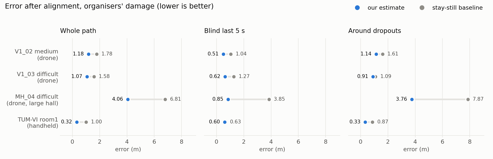
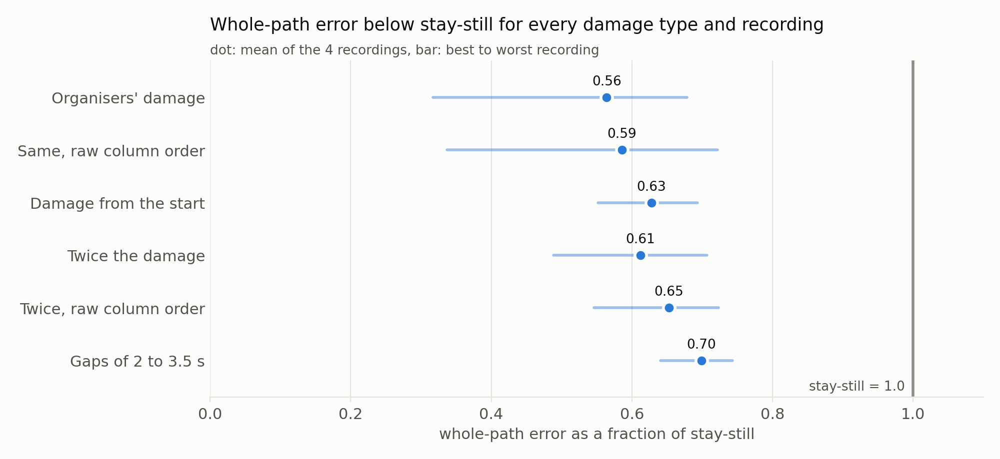
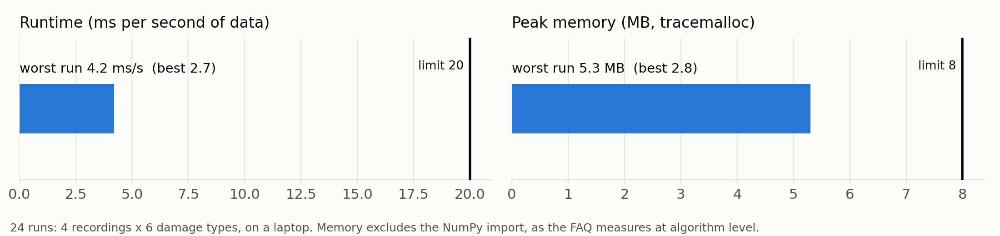

# Samsung PRISM XR Hackathon 2026 - Track 3: Path Finder

Estimate a 6-DoF trajectory from a degraded IMU recording only.

## Running the estimator

```
python src/main.py <imu0/data.csv | folder | zip> [estimated_trajectory.txt]
```

Python 3 and NumPy only, single thread. The input can be the csv, a folder that
holds `imu0/data.csv`, or a zip of that folder. The output is TUM format with
exactly one pose per input row and the input timestamps copied digit for digit
(nanoseconds written as seconds). Duplicated input rows get duplicated poses.

### How it works

| step | what it does | why |
| --- | --- | --- |
| read | streams the csv into float32 arrays | memory |
| clean | drops duplicate rows, stuck repeats and spikes (a sample far from the median of its neighbours, scaled by local noise), finds the all-zero ending | the script's damage types |
| resample | valid rows onto a uniform grid, gaps bridged by interpolation, gaps over 0.3 s flagged | dropouts |
| attitude | gyro integrated at full rate with the bias from the first 1.5 s, then the tilt pulled back to gravity using a 30 s average of world acceleration, separately between long gaps | stops tilt drift without erasing real motion |
| position | world acceleration averaged to 20 Hz, gravity removed, double-integrated in the frequency domain inside a band-pass | slow drift from bias and tilt error never builds up |
| shrink | horizontal gain 0.15 below 0.065 Hz and 1.0 above (both fitted per frequency band against the ground truth), height gain 0.3; position faded towards zero where the gyro is mostly noise | a path that is too big costs more than one that is too small |
| rotor drag | on a drone (found from motor buzz in the accelerometer), slow horizontal motion comes from drag instead: the accelerometer, read perpendicular to the measured thrust direction, gives -0.2 x velocity, which is velocity measured directly; where the buzz drops the drone is on the ground and the velocity is zero | velocity integrated once drifts far less than acceleration integrated twice |
| blind 5 s | coast for 0.3 s on the last velocity, then head for the estimated start point, averaged over the first 12 s | every practice recording ends within 0.45 m of where it began |
| write | poses interpolated onto every input timestamp, 1024 rows at a time | memory |

The idea behind the shrink: with an IMU alone, slow horizontal motion cannot be
told apart from a small tilt error (1 degree of tilt is 0.17 m/s^2 of false
acceleration, metres of error within half a minute). Fast motion and height are
much better. So the estimate keeps fast motion at full size and slow
horizontal motion at a sixth, and never lets drift accumulate.

The rotor-drag step is what sets this apart from plain inertial navigation. A
multirotor's thrust is along one body axis, so the accelerometer's other two
axes do not see gravity or thrust at all in flight, only rotor drag, which is
proportional to the velocity along them. Against the ground truth, every EuRoC
recording (five flights, two rooms) fits the same constant, 0.18 to 0.22 per
second, with correlation up to 0.98 on undamaged stretches. Dividing by it gives
velocity with no integration in it. The estimator switches it on only when the
accelerometer shows motor vibration (EuRoC 1.1 to 1.9 m/s^2 inside 50 ms
blocks, handheld TUM-VI 0.2 to 0.4), so handheld recordings are untouched.

Two details matter a lot. The EuRoC IMU is mounted about 20 degrees off the
thrust axis, so drag is read on the two directions perpendicular to the mean
specific force in flight, not on the sensor axes. And on the landing pad the
side axes read the pad's tilt, which looks like 2 m/s of velocity; blocks whose
motor buzz falls below 0.6 of the typical level are treated as ground, with zero
velocity. With both, the drag velocity explains 52 to 79% of the horizontal
motion between 0.01 and 0.045 Hz against the ground truth (10 to 50% without).
Two smaller refinements: the side-axis offsets are solved so that the mean
velocity in the room is zero (the flights end where they began), and the height
is held at one floor level wherever the drone is on the ground.
`python tools/plot_drag.py` draws the drag velocity against the motion-capture
velocity (`docs/figures/drag.png`).
Below 0.02 Hz the drag velocity's slowly wandering offset turns into drift once
integrated, but the slow motion is still there: a second-order high pass
(corner 0.015 Hz, gain 0.7) keeps it instead of cutting everything below 0.01 Hz.
A per-band fit against the ground truth showed the integrated drag velocity
still explains most of the motion between 0.003 and 0.02 Hz at a small gain.
For the blind 5 s on a drone, the target height is the floor level measured on
the ground stretches: in the ground truth every practice flight ends within
about 0.15 m of its take-off height.
A dropout longer than 0.3 s is never taken for the ground (its interpolated
samples carry no motor buzz), and the drag velocity is bridged across it: on the
2 s gap set the dropout error falls from 4.78 to 4.35 m on MH_04.

### Results (sarthak-v7, metres)

Organisers' damage, default column order:

| recording | stay-still ate | ours ate | ours / stay-still | stay-still blind | ours blind | stay-still gaps | ours gaps | rotation (deg) |
| --- | --- | --- | --- | --- | --- | --- | --- | --- |
| V1_02_medium | 1.78 | 1.18 | 0.66 | 1.04 | 0.51 | 1.61 | 1.14 | 3.2 |
| V1_03_difficult | 1.58 | 1.07 | 0.68 | 1.27 | 0.62 | 1.09 | 0.91 | 7.3 |
| MH_04_difficult | 6.81 | 4.06 | 0.60 | 3.85 | 0.85 | 7.87 | 3.76 | 16.2 |
| tumvi_room1 | 1.00 | 0.32 | 0.32 | 0.63 | 0.60 | 0.87 | 0.33 | 9.7 |

Every damage type, as a fraction of stay-still (mean of the 4 recordings, worst in brackets):

| damage | path | blind 5 s | around gaps |
| --- | --- | --- | --- |
| organisers' | 0.56 (0.68) | 0.54 (0.96) | 0.60 (0.84) |
| organisers', raw column order | 0.59 (0.72) | 0.62 (0.97) | 0.63 (0.89) |
| damage from the start | 0.63 (0.69) | 0.57 (1.14) | 0.68 (0.80) |
| twice the damage | 0.61 (0.71) | 0.50 (1.01) | 0.70 (0.96) |
| twice, raw column order | 0.65 (0.72) | 0.63 (1.06) | 0.74 (0.90) |
| gaps of 2 to 3.5 s | 0.70 (0.74) | 0.61 (1.06) | 0.88 (1.20) |

Over the 24 runs the path error is 0.62 of stay-still (v3, before rotor drag:
0.77) and below it in every run; the blind error is 0.58 of stay-still (v3:
0.98). Five runs are slightly worse than stay-still on one window: the blind 5 s
on tumvi_room1 under the four harsher sets (at most 0.09 m worse; the handheld
recording has no rotor drag to read velocity from), and the gaps on
V1_03_difficult with 2 to 3.5 s gaps (1.18 m against 0.98 m).

Peak memory is 3.3 to 5.3 MB (tracemalloc, after `import numpy`), runtime 2.3
to 3.3 ms per second of data on one laptop, 1.4 to 2.9 ms on another.





`python tools/plot_results.py` redraws these three from `results/results.csv`
(`--label` picks the version).
`python tools/evalall.py` prints these ratios for every local set at once,
`python tools/plot_path.py data/degraded/tumvi_room1` draws the estimate
against the ground truth.

### Held-out check (recordings never used for tuning)

| recording | stay-still ate | ours ate | ours, raw column order | stay-still blind | ours blind |
| --- | --- | --- | --- | --- | --- |
| V2_02_medium | 2.12 | 1.46 | 1.51 | 2.69 | 2.73 |
| MH_03_medium | 3.59 | 2.23 | 2.57 | 3.09 | 2.02 |
| tumvi_room2 | 1.22 | 0.32 | 0.34 | 0.72 | 0.68 |
| tumvi_room3 | 1.25 | 0.61 | 0.58 | 0.70 | 0.75 |
| tumvi_room4 | 1.08 | 0.77 | 0.79 | 0.78 | 0.76 |

All 10 runs beat stay-still on the path. Together with five EuRoC files cut to
start mid-flight, the 15 held-out runs average 0.68 of stay-still on the path
(worst 1.05, V2_02 cut to start mid-flight) and 0.90 on the blind 5 s. This check found two real bugs,
both fixed: idling motors on the pad were taken for movement, so the EuRoC gyro
bias (about 0.08 rad/s) was never removed; and a file that starts mid-flight
had no bias estimate at all. The rotor-drag step was tuned on the first four
recordings only and then checked here: it took the mid-flight MH_03 file from
1.43 of stay-still to 0.90.

A second check, on five more recordings fetched after the drag step was
finished (`data/extra`: MH_05_difficult, V1_01_easy, V2_01_easy, tumvi_room5,
tumvi_room6; 10 runs with both column orders), compared with the version before it:

| | path / stay-still | worst run | blind / stay-still |
| --- | --- | --- | --- |
| before rotor drag (sarthak-v3) | 0.88 | 1.29 | 1.08 |
| first rotor-drag version (sarthak-v4) | 0.75 | 0.97 | 0.83 |
| thrust direction and ground detection (sarthak-v5) | 0.72 | 0.98 | 0.74 |
| offsets, height pin, handheld gains (sarthak-v6) | 0.66 | 0.97 | 0.75 |
| slow drag motion kept (sarthak-v7) | 0.64 | 0.93 | 0.73 |

MH_05_difficult: path 4.02 m against 6.87 m for stay-still, blind 0.83 m against 4.09 m.

To repeat it: `python tools/fetch_euroc.py V2_02_medium MH_03_medium --out
data/holdout_clean`, `python tools/fetch_tumvi.py room2 room3 room4 --out
data/holdout_clean`, `python tools/prepare_data.py --clean data/holdout_clean
--out data/holdout`, then `python tools/score.py src/main.py --label holdout
--data data/holdout/degraded --gt data/holdout_clean`.

Known limits:

- The blind 5 s relies on the recording ending near where it started. A flight
  that ends somewhere else (V2_02) gets about stay-still there, no better.
- Rotor drag needs a multirotor. On handheld data the estimator falls back to
  the shrunk double integration. Walking speed was checked as a substitute
  (step rhythm in the accelerometer): on TUM-VI it does not follow the speed.
- The blind target is read from a second drag track without ground detection;
  on all three test groups it lands nearer the true start than the main track,
  which is an observation, not something derived.
- Orientation: heading (yaw) is not observable from an IMU alone, so a gyro
  bias that drifts makes it wander. With the raw column order or a mid-flight
  start the rotation error reaches 40 to 180 degrees on some files; with the
  default order and a still start it is 4 to 20 degrees.
- Start-up costs about 160 ms, nearly all of it the NumPy import. A file shorter
  than about 9 s goes over 20 ms per second (10 s: 17 ms/s, 3 s: 55 ms/s).
  Every EuRoC and TUM-VI recording is 80 s or longer.
- About 2.1 MB of tracemalloc peak is Python compiling the script itself, on any input.
- Tuning: `python tools/tune.py key=value ...` scores settings in-process.

## Practice data

Everything under `data/` is generated locally and not committed.

```
pip install -r requirements-dev.txt

# clean IMU + ground truth, written to data/clean/<name>/
python tools/fetch_euroc.py V1_02_medium V1_03_difficult MH_04_difficult
python tools/fetch_tumvi.py room1

# ground truth in TUM format, plus the damaged copies in data/degraded and data/degraded_raw
python tools/prepare_data.py
```

EuRoC is now hosted as one zip per room (6 to 12 GB) with each recording zipped
again inside it. `fetch_euroc.py` streams a single recording and keeps only the
IMU and ground truth files, so it transfers 0.7 to 1.1 GB per recording but
writes a few MB. Other names: `python tools/fetch_euroc.py --list V1` (also
`MH`, `V2`).

TUM-VI recordings are plain tar files, so `fetch_tumvi.py` finds the two csv
files with a handful of range requests and downloads about 5 MB.

`tools/degrade_imu.py` is the organisers' script, unchanged. It expects
`timestamp, accel, gyro` while EuRoC files are `timestamp, gyro, accel`, so
`make_degraded.py` swaps the columns before and after. `--raw-order` skips the
swap, in case the evaluation files were made that way. `prepare_data.py` makes
both. For a single file with other settings use `make_degraded.py` directly,
e.g. `--burst-len 5 400` for gaps up to 2 s.

## Scoring

```
python tools/score.py <estimator.py> --label <name>
```

The estimator is run as `python estimator.py <imu csv> <output txt>` on every
recording under `data/degraded`. One row per recording is printed and appended
to `results/results.csv`. Add `--data data/degraded data/degraded_raw` to score
more sets, `--no-save` to leave the table alone.

| column | meaning |
| --- | --- |
| format | `ok`, or what is wrong with the output file (row count, columns, nan, timestamps, quaternion norm) |
| ate_m | position RMSE after rigid alignment, same as `evo_ape tum gt est -a` |
| blind_m | same error, only over the all-zero rows at the end |
| gap_m | same error, from each dropout to 1 s after it |
| rpe_1s_m | drift over 1 s steps |
| rot_deg | orientation RMSE after alignment, same as `evo_ape -a -r angle_deg` |
| ms_per_s | runtime per second of data, imports included, best of 3. Limit 20 |
| mem_mb | tracemalloc peak on top of what `import numpy` already holds. Limit 8 |
| mem_with_imports_mb | tracemalloc peak counting everything |

Stay-still baseline, the numbers to beat (metres):

| recording | length | ate_m | blind_m | gap_m |
| --- | --- | --- | --- | --- |
| V1_02_medium | 85 s | 1.78 | 1.04 | 1.61 |
| V1_03_difficult | 107 s | 1.58 | 1.27 | 1.09 |
| MH_04_difficult | 102 s | 6.81 | 3.85 | 7.87 |
| tumvi_room1 | 141 s | 1.00 | 0.63 | 0.87 |

Every scored version is in `results/results.csv`.

## Stress sets

```
python tools/prepare_data.py --stress
python tools/score.py <estimator.py> --label <name> --stress
```

| set | what changes |
| --- | --- |
| gaps2s | bursts up to 400 rows and twice as often, longest gap 2.0 to 3.5 s |
| harsh | damage level 2.0, twice the organisers' maximum |
| early | gamma 0.7, so the damage arrives early instead of at the end |
| harsh_raw | harsh, with the script fed EuRoC column order |
| short10 | first 10 s only, half of it is the all-zero ending |
| short3 | first 3 s only, too short for the script to add a zero ending |
| tiny | 4 or 5 rows |

An estimator that crashes, hangs (`--timeout`, 120 s by default) or writes a bad
file gets a row saying so in the `format` column and the run carries on.

What the two reference estimators showed:

- Neither crashes or writes a bad file on any set.
- Stay-still error barely moves with the damage (it ignores the data), so these
  sets only tell us something once a real estimator is scored on them.
- Fixed start-up cost matters on short files. Stay-still spends 0.6 ms/s on a
  full recording but 8 ms/s on a 3 s file, with no NumPy import at all. If the
  evaluation file is short, a 100 to 150 ms NumPy import alone could use most
  of the 20 ms/s.
- Plain integration is 18 m off after 10 s and 0.5 to 0.9 m off after 3 s.
- Both Vicon Room recordings start with the drone still for the first few
  seconds, which is what the 2 s calibration window needs.

Notes:

- ate_m and rot_deg agree with evo to 3 decimals on a test path.
- evo accepts files with repeated timestamps, so we keep one pose per input row.
- `evo_ape -a` refuses a path that never moves ("Degenerate covariance rank").
  `score.py` falls back to a shift only, so the stay-still baseline still gets a number.
- `import numpy` alone shows up as about 6.7 MB in tracemalloc. The FAQ says memory
  is measured at the algorithm / heap level, so we report `mem_mb`. Counting the
  import, 8 MB is not reachable with NumPy.
- `tools/naive_integrate.py` is plain integration with no bias handling, kept as
  a reference. It ends up kilometres off, so stay-still is the real bar. It also
  holds every row as Python floats and already uses 6 to 10 MB doing so.
- EuRoC ground truth starts about 1 s after the IMU file and stops about 1 s
  before it ends, so only 4 of the last 5 blind seconds can be scored.
- With `--raw-order` the script reads the gyro columns as accel in g, so the
  gyro gets about 0.02 rad/s of noise at the end and the accel almost none.

## Layout

```
tools/   data download, degradation, scoring
data/    local only
results/ results.csv is tracked, the rest is local
```
